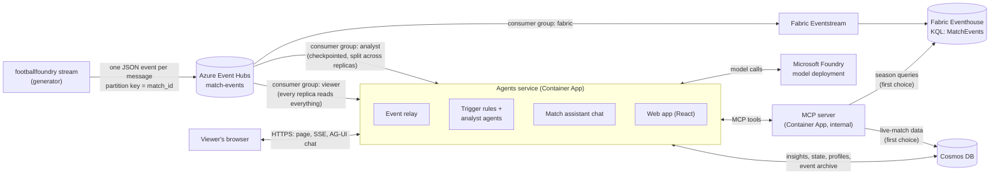
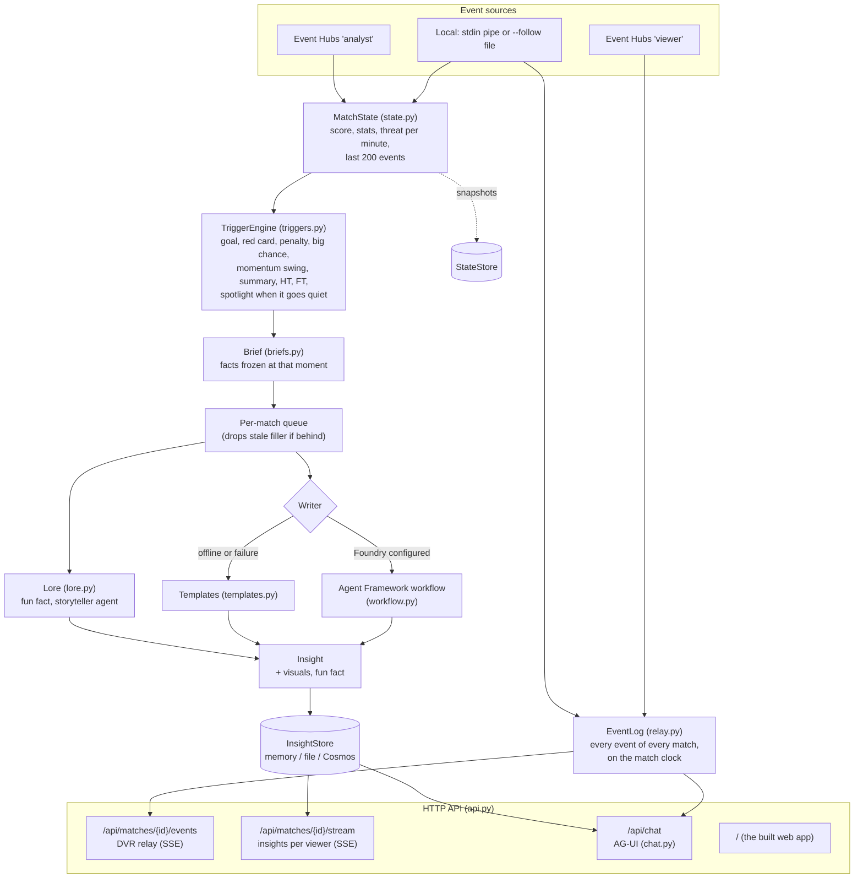
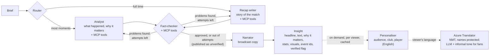
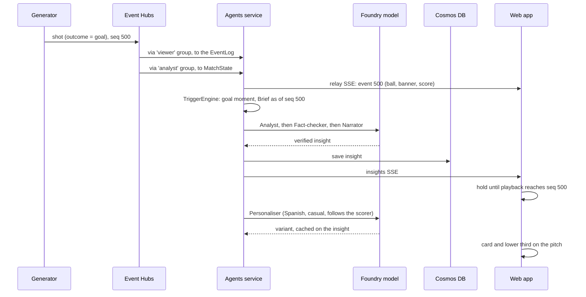
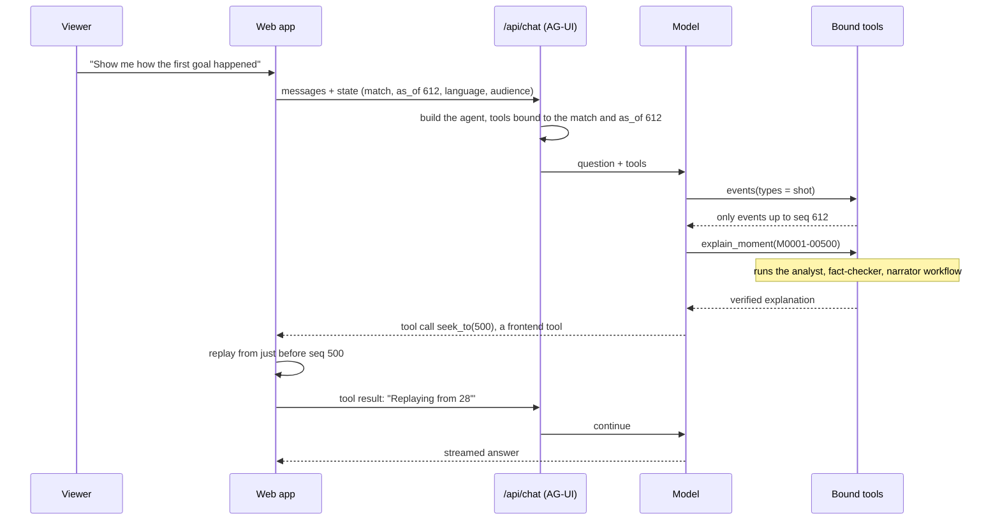
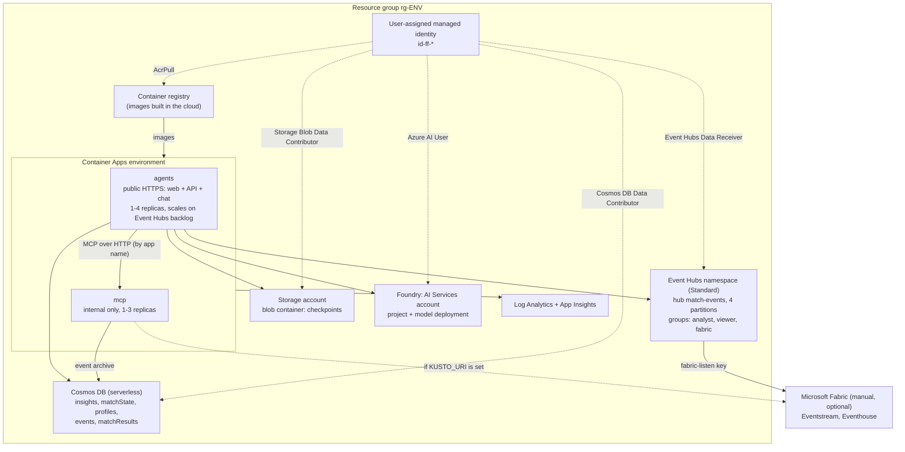
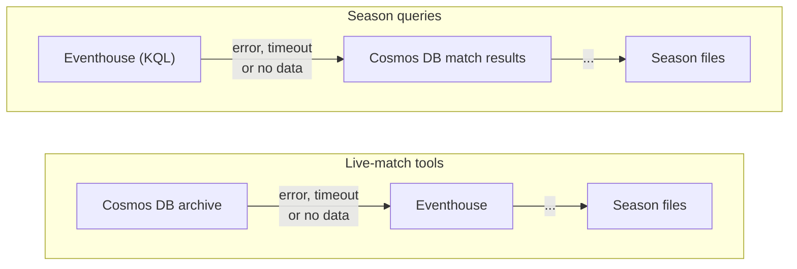
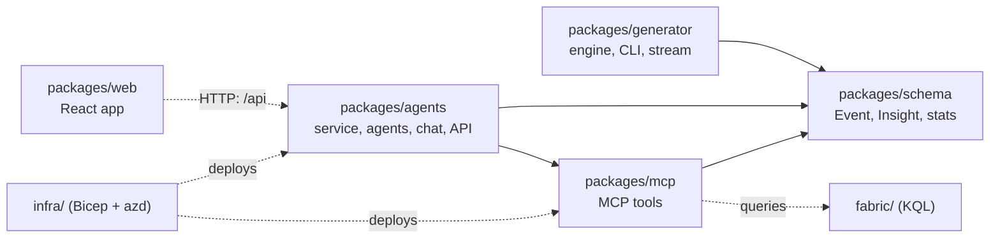

# FootballFoundry design

How the pieces fit together: the data flow, the agents service, the multi-agent workflow, the chat, and the Azure
infrastructure `azd up` creates. For how to run things, see the [README](README.md) and each package's README.

- [1. The big picture](#1-the-big-picture)
- [2. Inside the agents service](#2-inside-the-agents-service)
- [3. The multi-agent workflow](#3-the-multi-agent-workflow)
- [4. A goal, from kick to screen](#4-a-goal-from-kick-to-screen)
- [5. Chat with the match assistant](#5-chat-with-the-match-assistant)
- [6. Azure infrastructure](#6-azure-infrastructure)
- [7. Packages in the repository](#7-packages-in-the-repository)
- [Design decisions](#design-decisions)

## 1. The big picture

The generator produces a live match. Event Hubs fans the events out to three independent readers. The agents
service turns them into insights and serves the web app.

Each reader has its own consumer group, so each moves at its own pace:

| Consumer group | Reader | Behaviour |
| --- | --- | --- |
| `analyst` | The agents' analysis | Checkpointed to Blob Storage; replicas split the partitions between them |
| `viewer` | The agents' event relay, which feeds the pitch in the web app | No checkpoints; every replica reads every partition from the start of retention |
| `fabric` | Fabric Eventstream → Eventhouse | Analytics, dashboards and the MCP server's season queries |

## 2. Inside the agents service

One Python process (`footballfoundry-agents serve`) runs two loops: consuming events and serving HTTP.

- **Event handling never waits for a model.** Moments go onto a per-match queue, and one writer per match keeps
  insights in order. If the agents fall behind, waiting filler (rolling summaries) is dropped so the overlay stays
  close to live.
- **Briefs freeze the facts at trigger time.** A slow model call can't see events that happened after the moment.
  The visuals a moment can show (a replay of the move, the xG race, the shot map...) are built then too, in code,
  so their numbers are always the real ones.
- **The analysts take the initiative.** When no insight has fired for 10 real seconds and 3 match minutes, a
  spotlight moment asks them to find a story in the data (the player running the game, possession without threat,
  a busy keeper...); code suggests the best one.
- **A fun fact for casual fans** about a player or club in the moment, from the league data, is picked while the
  analysts write; with Foundry, the storyteller agent retells it in five languages.
- **Restarts and redeliveries are safe.** Insight ids are deterministic (`<match>-<kind>-<seq>`), match state
  ignores events it has already seen, and state is snapshotted at every moment and every 100 events.

## 3. The multi-agent workflow

Each trigger runs one Microsoft Agent Framework workflow. The agents share one Foundry model deployment but each
has its own role and instructions.

| Agent | Job | Tools |
| --- | --- | --- |
| Analyst | What happened, how it was created, why it matters; cites event ids; picks and captions the visuals; on a spotlight, chooses the story | MCP |
| Recap writer | The full-time story, from the timeline of earlier insights | MCP |
| Fact-checker | Checks every claim, visual captions included; sends problems back to the author (up to 2 attempts) | MCP |
| Narrator | Broadcast copy from the approved analysis only | none |
| Personaliser | Rewrites per audience, favourite club and followed player, without new facts | none |
| Storyteller | Retells a league fact as a short "Did you know?" story for casual fans, in five languages | none |
| Azure Translator | Not an agent: translates the personalised English into the viewer's language, names protected | n/a |

Agents hand off typed Pydantic outputs, not free text. If any step fails or times out, a template insight is
published instead, so a goal is never missed because a model call was.

## 4. A goal, from kick to screen

The web app holds each insight until playback reaches its `seq`, so viewers replaying the match, or watching behind
live, are never spoiled.

## 5. Chat with the match assistant

The chat speaks [AG-UI](https://docs.ag-ui.com) through Agent Framework's `agent-framework-ag-ui`. The viewer's
playback position is bound into the tools **on the server**, so the assistant can't look ahead whatever the model
asks. Frontend tools (`seek_to`, `focus_player`, `set_view`) are declared by the page and run in the browser, so the
assistant can act on what the viewer sees.

| Tool | Source |
| --- | --- |
| `match_state`, `events`, `player_stats`, `lookup`, `insights` | The relay log and the insights store, up to `as_of` |
| `season_query` | The MCP server, matchdays before this match only |
| `explain_moment` | Hands one moment to the analyst workflow and returns the verified explanation, with its visuals |
| `show_visual` | Draws a chart or a move replay under the answer (works offline too, by keyword) |
| `lore` | A player's or club's profile and fun facts, for casual fans |
| `seek_to`, `focus_player`, `set_view` | The web page |

## 6. Azure infrastructure

What `azd up` creates from [`infra/`](infra/):

- **Identity:** one user-assigned managed identity for both apps. There are no keys in code. Cosmos DB, Foundry and
  Storage have key authentication turned off. The single exception is a listen-only key on the event hub for Fabric
  Eventstream (set `fabricEventstreamAccess` to `false` to remove it).
- **Network:** the agents app is the only public endpoint. The MCP server is reachable only inside the Container Apps
  environment.
- **Scaling:** the agents app scales on the Event Hubs backlog. Each match stays on the replica that owns its
  partition, while every replica's relay reads the whole stream, so any replica can serve any viewer.
- **Observability:** container logs go to Log Analytics; Agent Framework's OpenTelemetry traces (each agent run and
  tool call) go to Application Insights.
- **Not in the templates:** Microsoft Fabric. It's optional and set up by hand ([fabric/README.md](fabric/README.md));
  without it, the MCP server reads the season data baked into its image.

### The MCP server's fallback chain

Each source gets a few seconds; a failure is logged and the next one answers. Match tools return a `source` field
saying which one did. The archive comes first for live matches because Eventstream ingestion can trail the stream by
seconds or minutes, while the agents write each event as it's analysed.

## 7. Packages in the repository

The four Python packages share one [uv workspace](https://docs.astral.sh/uv/concepts/projects/workspaces/) and
lockfile. The web app is built with npm and copied into the agents image, which serves it.

## Design decisions

| Decision | Why |
| --- | --- |
| Event Hubs, not self-hosted Kafka | Fully managed, Entra ID sign-in, native Fabric Eventstream source, low cost at this scale |
| Container Apps, not AKS | Two services: built-in HTTPS, managed identity and KEDA scaling without operating a cluster |
| Trigger rules in code, agents only for explanations | ~1,900 events a match, but only ~15-20 moments worth explaining; fast, cheap and predictable |
| Facts frozen in a brief at trigger time | A slow model can't leak what happened after the moment |
| Fact-checker loop and template fallback | Explanations are checked against the data, and a failed model call never loses a moment |
| Tools bound to `as_of` on the server | Spoiler safety doesn't depend on the model following instructions |
| Web app served by the agents container | One origin for the page, API, SSE and chat: no CORS, one fewer Azure resource |
| Cosmos DB serverless | Insights, state snapshots and profiles are small JSON documents; pay per request |
| Events in both Cosmos DB and the Eventhouse | Each event is sent once and fanned out by Event Hubs. Cosmos DB (written by the agents) is current as events arrive and serves the MCP server's live-match tools; the Eventhouse serves analytics and season queries. Each is the other's fallback, so a Fabric outage or ingestion lag doesn't starve the agents |
| Personalise in English, then Azure Translator | The fact-checked English stays the source of truth: neural translation can't add facts, names are protected, it's fast and cheap; Translator's LLM option adds tone for casual fans. The personaliser still translates if Translator is unavailable |
| MCP server as a separate app | The same match-data tools serve the agents, the chat and any MCP client (Copilot, VS Code) |
