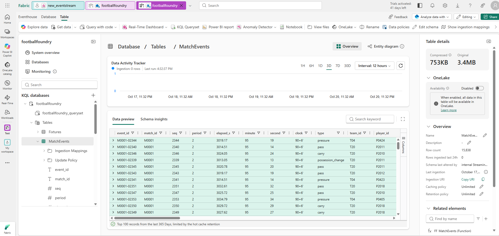
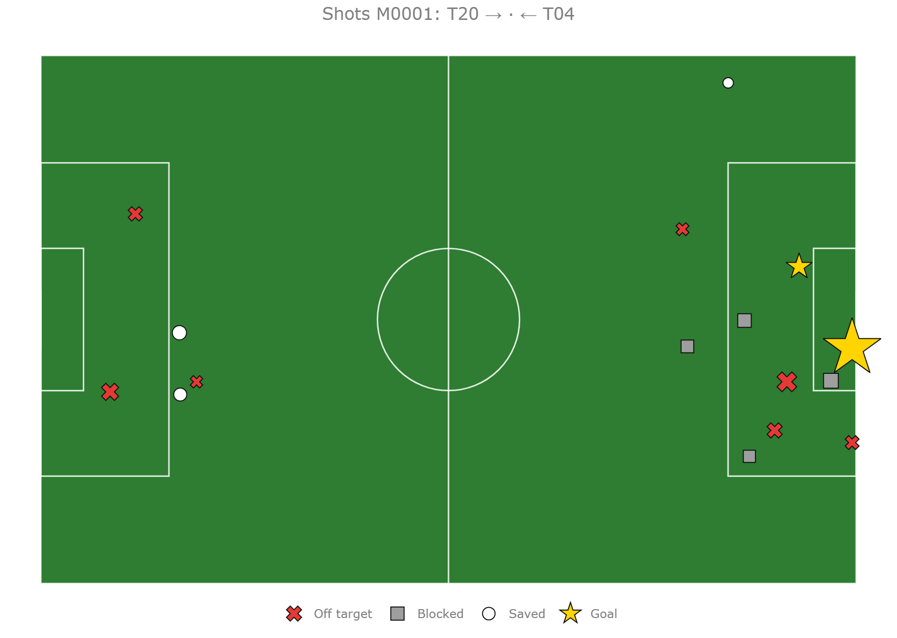
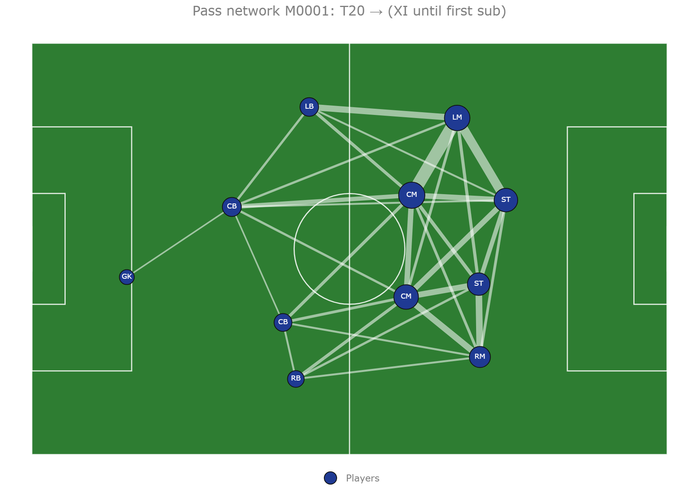
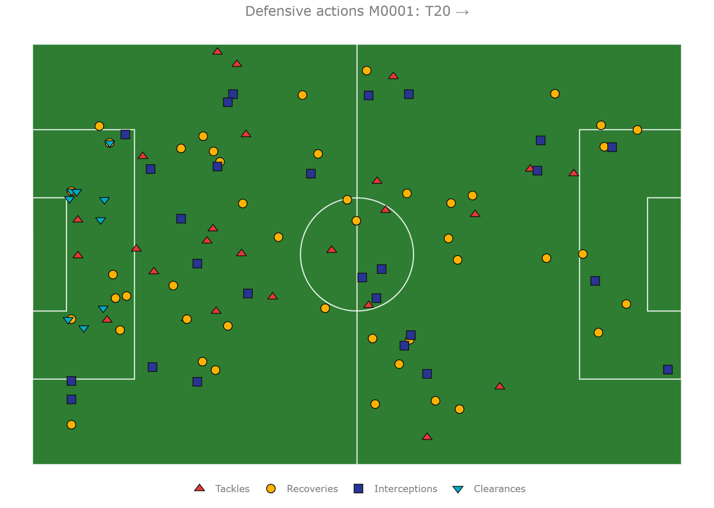

# Microsoft Fabric: Eventstream and Eventhouse



Every event lands in an Eventhouse (KQL database) for analytics, dashboards and the MCP server's season queries.
These steps are done in the Fabric portal. Fabric's Git integration can then save the items into this folder.

```text
Event Hubs match-events ──(consumer group "fabric")──► Eventstream ──► Eventhouse: MatchEvents
                                                                              │
                                     footballfoundry-mcp (KustoBackend) ◄─────┤ FF_* functions
                                     Real-Time Dashboard, Activator      ◄────┘
```

## 1. Eventhouse and tables

1. In a Fabric workspace, create an **Eventhouse** named `footballfoundry`. It comes with a KQL database of the same
   name.
2. Open a KQL queryset on the database and run [`eventhouse/tables.kql`](eventhouse/tables.kql), then
   [`eventhouse/functions.kql`](eventhouse/functions.kql).
3. Load the fixture list (it maps each match to its matchday, which the season queries need):

   ```bash
   footballfoundry world
   python fabric/eventhouse/fixtures_to_kql.py data/fixtures.json > fixtures.kql
   ```

   Paste `fixtures.kql` into the queryset and run it.

## 2. Eventstream

1. Create an **Eventstream** named `match-events`.
2. Add a source: **Azure Event Hubs**. Namespace and hub from `azd env get-values` (`EVENTHUB_NAMESPACE`,
   `match-events`), consumer group **`fabric`**, data format **JSON**. For the connection, use the shared access key
   of the `fabric-listen` rule (Event Hubs → match-events → Shared access policies).
3. Add a destination: **Eventhouse**, direct ingestion, database `footballfoundry`, existing table `MatchEvents`,
   format JSON, mapping `MatchEventsMapping`.
4. Publish, then stream a match (`footballfoundry stream --sink eventhub`) and check:

   ```kusto
   MatchEvents | summarize events = count(), last = max(seq) by match_id
   ```

## 3. Let the MCP server read it

Copy the Eventhouse **Query URI** and grant the apps' managed identity (`id-ff-*`) **Viewer** on the KQL database
(Database → Manage → Permissions). Then `azd env set KUSTO_URI <query URI>` and `azd provision`. Locally:
`footballfoundry-mcp --kusto-uri <query URI>` signs in with `az login`.

## Functions

| Function | Used by `season_query` | Returns |
| --- | --- | --- |
| `FF_MatchEvents(m, s)` | match tools | Events of one match up to seq `s`, latest run only |
| `FF_Results(md)` | | Final scores of matches before matchday `md` |
| `FF_Standings(md)` | `standings` | League table |
| `FF_TopScorers(md, n)` | `top_scorers` | Top `n` scorers |
| `FF_TeamForm(club, md, n)` | `team_form` | A club's last `n` results |
| `FF_PlayerSeason(player, md)` | `player_season` | Appearances, goals, shots, xG |
| `FF_HeadToHead(a, b, md)` | `head_to_head` | Earlier meetings |

Streaming the same match twice ingests it twice. The functions count each `event_id` once, and `FF_MatchEvents`
returns only the latest run.

## 4. Real-Time Dashboard visuals

A Real-Time Dashboard tile is a KQL query plus a visual type. Lines, areas, columns, scatter, pie, heatmap (by
category) and stats are built in. For pitch visuals (shot maps, pass networks, touch and defensive maps) and radars,
use the **Plotly** visual (preview). The query returns one cell of Plotly JSON, built by the database's Python plugin.

| Analytics visual | How |
| --- | --- |
| xG race, intensity over time, sprint distance by period, xG for/against | Built in: line, area or column chart |
| Shot map, pass network, defensive and touch maps | Plotly: `FF_Pitch` plus a data function |
| Hexbin heat map on the pitch, player radar | Plotly: `Histogram2d` or `Scatterpolar` in the same way |

### Set up

1. Turn on the Python plugin: Eventhouse → **Plugins** → **Python language extension**. It takes a few minutes.
2. Run [`eventhouse/visuals.kql`](eventhouse/visuals.kql) in the queryset (after `functions.kql`).
3. Create a **Real-Time Dashboard**, add the Eventhouse as a data source, and add one tile per query below. For the
   pitch tiles, set **Visual type** to **Plotly**. Set auto refresh (Manage → Auto refresh) to follow a live match.

```kusto
FF_ShotMap("M0001")                     // Plotly
FF_PassNetwork("M0001", "T20")          // Plotly; optional 3rd argument: minimum passes per link (default 3)
FF_DefensiveActions("M0001", "T20")     // Plotly
FF_XgRace("M0001")                      // Line chart: x = minute, y = xg, series = team_id
```

To pick the match and team from dashboard parameters, declare `_match` and `_team` parameters and use
`FF_ShotMap(_match)`.

### How the pitch tiles work

`FF_Pitch(T, title)` is the only function with Python in it. It draws a 105m x 68m pitch and then the rows of `T` on
it. Each row is a line or a marker, styled by its own columns:

| Column | Meaning |
| --- | --- |
| `layer` | `"line"` (from `x,y` to `end_x,end_y`) or `"point"` (a marker at `x,y`) |
| `series` | Legend entry (points are grouped by it) |
| `x`, `y`, `end_x`, `end_y` | 0-100 in the schema's frame: `x` runs from own goal to the opponent's goal (drawn left to right) |
| `size` | Marker diameter or line width, in pixels |
| `color`, `symbol` | Any CSS colour; any Plotly marker symbol (`circle`, `star`, `x`, `triangle-up`, ...) |
| `label`, `hover` | Text on the marker; tooltip |

A new pitch visual is a KQL query that returns those columns, followed by `| invoke FF_Pitch("title")`. For example,
a touch map for one player:

```kusto
FF_MatchEvents("M0001", 1000000)
| where player_id == "P2026" and isnotnull(x)
| project layer = "point", series = type, x, y, end_x = real(null), end_y = real(null), size = 9.0,
    color = "#ffb300", symbol = "circle", label = "", hover = strcat(clock, " ", type)
| invoke FF_Pitch("Touches P2026")
```

The Python plugin is slower than plain KQL. Do the filtering and aggregation in KQL so that only a few hundred rows
reach `FF_Pitch`.

### Preview without Fabric

[`eventhouse/preview_visuals.py`](eventhouse/preview_visuals.py) runs `FF_Pitch`'s Python code, read from
`visuals.kql`, on a local events file. The data prep is redone in pandas.

```bash
uv run --with pandas --with plotly --with kaleido python fabric/eventhouse/preview_visuals.py data/events/M0001.jsonl
```

| Shot map | Pass network | Defensive actions |
| --- | --- | --- |
|  |  |  |

## Next

- More dashboard tiles: possession by 5-minute window, physical load from each team's `period_end`.
- **Activator** alerts, for example when one side's xG lead passes 1.5, notify the studio producer.
