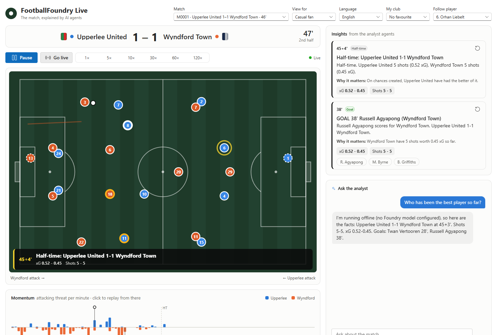

# footballfoundry-web

The FootballFoundry web app: the live match, the analyst agents' insights written for each viewer, and a chat with
the match assistant. React + TypeScript, built with Vite, using Fluent UI. In production the agents service
serves it, so the page, its API and the chat share one origin.



## Run it

```bash
# 1. The agents service, fed by a live stream (offline = no Azure; see packages/agents for Foundry)
footballfoundry world
footballfoundry stream --matchday 1 --speed 30 --quiet | footballfoundry-agents serve --offline
# Or in two terminals, started in either order: the stream writes a file, the service follows it
footballfoundry-agents serve --offline --follow data/stream.jsonl
footballfoundry stream --matchday 1 --speed 30 --sink file --out data/stream.jsonl

# 2a. Development: hot reload on http://localhost:5173, API proxied to :8100
cd packages/web && npm install && npm run dev

# 2b. Or build once and let the agents service serve it on http://127.0.0.1:8100
cd packages/web && npm run build
```

## What's on the page

| Part | What it does |
| --- | --- |
| Header | Match picker (every match the agents have seen), and the viewer's settings: audience (casual fan, broadcast, analyst, player focus), language, favourite club, followed player. Settings are remembered and saved as a profile, so the agents personalise for this viewer |
| Scoreboard, pitch, momentum, stats, feed | The original viewer, ported to TypeScript. It plays the **same events the agents analyse**, relayed by the agents service |
| Playback | Follow live, pause, replay at 1-120×, or replay from any minute (click the momentum strip). A DVR over the match |
| Insights | The agents' insights for this viewer, as cards and as a broadcast-style lower third on the pitch. An insight appears only once playback reaches it, so replays never spoil what comes next. Replay a moment from its card; tap a player to follow them. The first card, at kick-off, previews the match. Cards carry **visuals**: an animated replay of the move behind a goal or chance (a goals reel at full time), the xG race, a shot map, momentum or a head-to-head. **Casual fans** also get a "Did you know?" about a player or club. When the match goes quiet, a **Spotlight** card tells a story the agents found themselves |
| Ask the analyst | Chat with the match assistant over [AG-UI](https://docs.ag-ui.com). It only knows the match up to where you are, answers in your language and style, can draw charts and move replays under its answers, and can act on the page: replay a moment, follow a player, change the view |

**Season** (`/season`): the simulated season, up to any matchday (the picker, or ‹ ›). While a match is live, it shows
the standings before that matchday, so nothing is spoiled; one click shows everything.

| Tab | What it does |
| --- | --- |
| Table | Position and movement since the last matchday, played / won / drawn / lost, goals, points, the last five results, the next fixture; European places and relegation marked. Your club is highlighted. Click a club for its players |
| Stats | Player leaders (goals, assists, xG, chances created, shots on target, tackles, interceptions, clean sheets, saves, distance, top speed) and club leaders (goals, fewest conceded, clean sheets, xG, possession, pass accuracy). Click a player for their profile, or "All" for the full ranking |
| Players | Every player: search, club, position, sort by any column, per-90 view. Click a player for a profile with season totals, physical data and match-by-match log |

Tabs, filters, sorting, the matchday and an open player are kept in the address, so a view can be shared or
reloaded. `/control` is the testers' control room ([agents README](../agents/README.md#control-room)).

## How it works

| File | Role |
| --- | --- |
| [`src/match/engine.ts`](src/match/engine.ts) | The match player: event relay connection, match state, playout buffer and the 60 fps pitch animation, outside React. React reads a throttled snapshot |
| [`src/components/Chat.tsx`](src/components/Chat.tsx) | `@ag-ui/client` `HttpAgent` against `POST /api/chat`. Sends the page state (match, playback `as_of`, viewer settings) with every message, and runs the frontend tools the assistant calls (`seek_to`, `focus_player`, `set_view`) |
| [`src/components/Insights.tsx`](src/components/Insights.tsx) | SSE from `/api/matches/{id}/stream` with the viewer's settings; holds insights back until playback reaches them |
| [`src/components/Visual.tsx`](src/components/Visual.tsx) | Draws the visuals in insights and chat answers as SVG: the move replay (looping like a GIF, paused when off screen or with reduced motion), shot map, xG race, momentum and head-to-head, in the app's light and dark themes |
| [`src/components/Trivia.tsx`](src/components/Trivia.tsx) | The casual fan's "Did you know?": the storyteller's own translation, or the fact worded in the viewer's language from its `key` and `params` |
| [`src/store.ts`](src/store.ts) | Viewer settings (remembered in the browser) and the playback position shared by insights and chat |
| [`src/i18n.ts`](src/i18n.ts) | Interface text in English, Spanish, French, Portuguese and German. Insights and chat answers come from the agents in any language |

**Spoiler safety** holds everywhere: the relay sends only what has happened, insights wait for playback, and the
chat sends `as_of` with each message. The server binds the assistant's data tools to it, so the assistant can't
look ahead even if it tries.
